  

  

  

  

- 🕷️ Desarrollo full stack: APIs (Java, TypeScript) y frontends en Vue
- 🕸️ Homelab: servidores, contenedores y automatización
- 🕷️ Aprendiendo siempre algo nuevo en Linux

  
💥 <b>Clic aquí para un dato curioso 🕸️</b>

   
  Si un proyecto no rompe al menos una vez en producción… ¿de verdad fue desplegado? 😅

  

  

  

  
  

  

  

  

  

  

  

